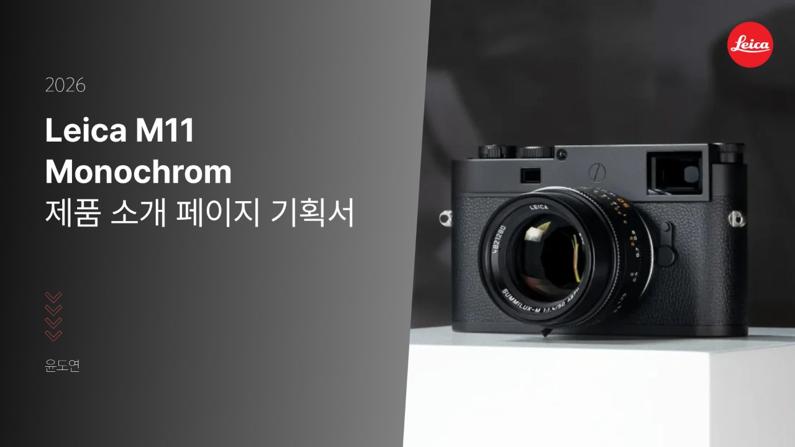

# Leica M11 Monochrom — 제품 소개 페이지

>흑백 전용 카메라, Leica M11 Monochrom을 스크롤 인터랙션을 활용해 소개하는 랜딩 페이지입니다.

<br>

## 📌 프로젝트 개요

| 항목 | 내용 |
|---|---|
| 프로젝트 구분 | 개인용 포트폴리오 |
| 프로젝트 종류 | 제품 소개용 랜딩 페이지 (반응형) |
| 작업자 | 윤도연 (기여도 100%) |
| 사용 툴 | Figma, Photoshop, Visual Studio Code, Claude Code |
| 작업 기간 | 2026년 10월 27일 ~ 10월 30일 / 작업 기간 4일 (일 평균 4시간, 총 16시간) |

**🔗 사이트 보기: https://leica-m11-monochrom.vercel.app**

<br>


<table>
  <tr>
    <td width="66%"></td>
    <td width="34%"></td>
  </tr>
  <tr>
    <td align="center">PC · 특징 섹션</td>
    <td align="center">모바일 · 첫 화면</td>
  </tr>
</table>

> **안내** — 이 저장소는 라이카(Leica Camera AG, 라이카 카메라 코리아)와 관련 없는 **개인 포트폴리오**입니다.
> 제품 이미지·명칭·상표의 권리는 각 권리자에게 있으며, 실제 제품과 구매는 [라이카 공식 스토어](https://www.leica-store.co.kr)에서 확인해 주세요.

<br>

## 📝 기획서

페이지의 기획 의도와 작업 과정은 기획서에 정리했습니다.<br>
👇 $\color{red}{\textbf{이미지를 누르면 기획서가 열립니다.}}$

<a href="https://canva.link/wj6r2l2ybzvvi6i"></a>

<br>

## 🎨 디자인 시스템

모든 색과 글자 크기는 `style.css` 맨 위 `:root`에 토큰으로 정리했습니다.

**컬러 — 무채색 + 라이카 노랑 하나**

| 토큰 | 값 | 쓰임 |
|---|---|---|
| `--c-yellow` | `#f2c230` | 강조색: 소제목 줄, 선택 상태, 구매하기 |
| `--c-ivory` | `#f4f2ef` | 어두운 바탕 위 글자, 밝은 폼 면 |
| `--c-gray-light` | `#b8b8b6` | 첫 화면 포스터 문구 |
| `--c-raised` | `#2b2b2b` | 바탕 4단계 · 가장 밝은 회색 |
| `--c-surface` | `#1d1d1d` | 바탕 3단계 · 사진 자리 |
| `--c-ink` | `#141414` | 바탕 2단계 · 갤러리·상담 예약 |
| `--c-black` | `#0a0a0a` | 바탕 1단계 · 푸터 |

**타이포그래피 — Pretendard (영문 포스터 문구만 Chonburi)**

- 제목은 `clamp()`로 화면 크기에 따라 자동 조절: `--fs-poster-en`, `--fs-display`, `--fs-section`, `--fs-product` …
- 본문·UI는 고정 단계: `--fs-input`(16) · `--fs-body`(15) · `--fs-ui`(14) · `--fs-small`(13) · `--fs-eyebrow`(12) · `--fs-micro`(11) …
- 토큰 이름은 크기 숫자가 아니라 **쓰임(역할)** 으로 지어, 값을 바꿔도 이름이 어긋나지 않게 했습니다.
<br>

## 🛠️ 기술 스택 · 폴더 구조

**스택** — 빌드 도구 없는 순수 HTML · CSS · JavaScript / Pretendard · Chonburi 폰트 / Font Awesome 6 아이콘 / Vercel 배포

```
├── index.html          마크업
├── style.css           모든 스타일 · 반응형 · 디자인 토큰(:root)
├── script.js           모든 동작 (3D 구체, 스크롤 연출, 갤러리, 액세서리, 폼 검사 …)
├── accessories.json    액세서리 섹션 데이터 (분류 5개 · 제품 14개)
├── images/             사진 · 제품 이미지 · 영상
├── fonts/              Chonburi, Pretendard 가변 글꼴 부분판 (둘 다 OFL 1.1, 라이선스 파일 포함)
└── docs/               README 이미지
```

<br>

## 💭 회고

**알게 된 점**

처음에는 3D 구체, 스크롤 고정, 배경 영상처럼 보여 주고 싶은 연출을 최대한 담으려 했습니다. 그런데 모바일에서 확인해 보니 페이지가 무겁고 조작도 번거로웠습니다. 그래서 모바일은 연출을 덜어 내고, 사진 24장을 한 장의 이미지로 합쳐 약 24MB를 58KB까지 줄였습니다. 이 과정에서 때로는 연출을 더하는 것보다 덜어 낼 것을 고르는 판단이 더 중요하다는 것을 알게 되었습니다.

**개선 방향**

지금 상담 예약 폼은 입력값을 검사만 하고 실제로 전송하지는 않습니다. 다음에는 폼 전송 서비스를 연결해 실제로 접수되게 만들고 싶습니다. 또 각 섹션별 명도 대비를 점검해, 누구나 편하게 볼 수 있는 페이지로 다듬을 계획입니다.
