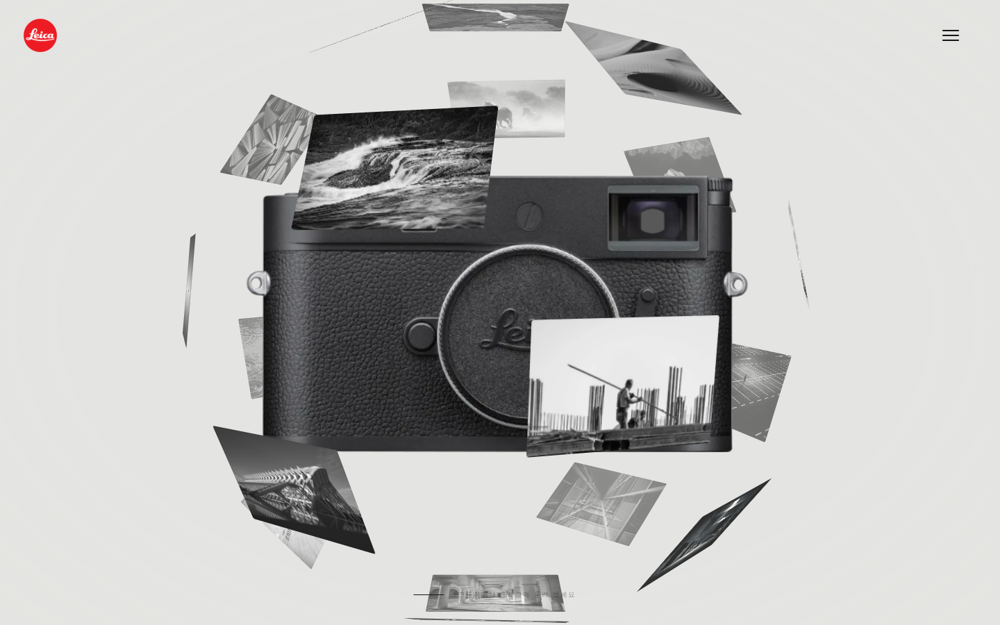
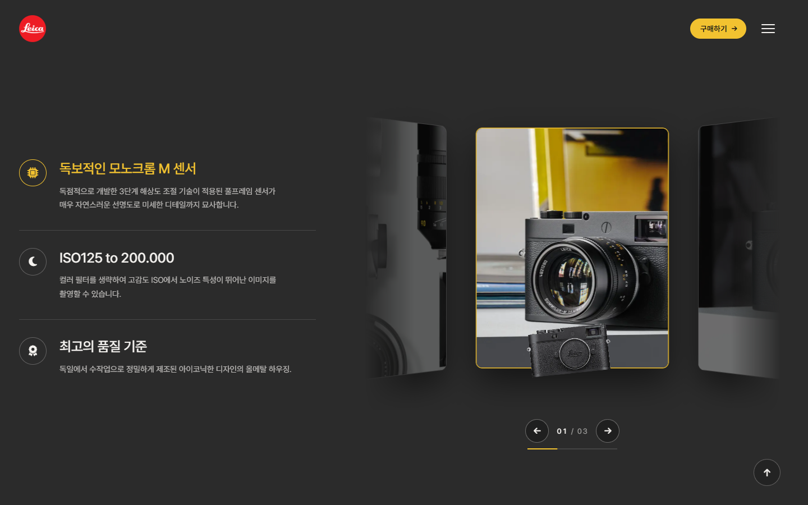
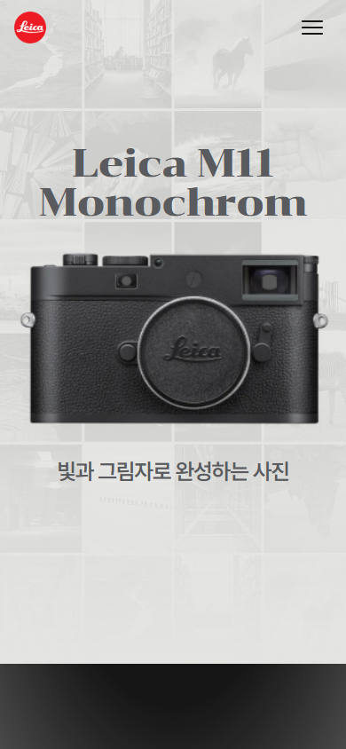

# Leica M11 Monochrom — 비공식 프로모션 페이지

> 빛과 그림자만으로 완성하는 흑백 전용 카메라, Leica M11 Monochrom을 스크롤 인터랙션으로 소개하는 웹 페이지입니다.

**🔗 사이트 보기: https://leica-m11-monochrom.vercel.app**



<table>
  <tr>
    <td width="66%"></td>
    <td width="34%"></td>
  </tr>
  <tr>
    <td align="center">PC · 특징 섹션</td>
    <td align="center">모바일 · 첫 화면</td>
  </tr>
</table>

> **안내** — 이 저장소는 라이카(Leica Camera AG, 라이카 카메라 코리아)와 관련 없는 **개인 포트폴리오**입니다.
> 제품 이미지·명칭·상표의 권리는 각 권리자에게 있으며, 실제 제품과 구매는 [라이카 공식 스토어](https://www.leica-store.co.kr)에서 확인해 주세요.

<br>

## 목차

- [섹션 구성](#섹션-구성)
- [PC와 모바일을 다르게 설계한 이유](#pc와-모바일을-다르게-설계한-이유)
- [디자인 시스템](#디자인-시스템)
- [고민하고 해결한 점](#고민하고-해결한-점)
- [접근성](#접근성)
- [기술 스택 · 폴더 구조 · 실행 방법](#기술-스택--폴더-구조--실행-방법)

<br>

## 섹션 구성

| # | 섹션 | 핵심 연출 (PC) |
|---|---|---|
| 1 | **첫 화면** | 카메라를 중심으로 흑백 사진 21장이 3D 구체를 이루고, 스크롤하면 한 바퀴 회전. 회전 진행에 맞춰 포스터 문구가 차례로 등장 |
| 2 | **제품 소개** | 화면에 고정된 채 3단계로 문구가 바뀌고, 단계마다 컬러 사진이 빛줄기와 함께 흑백으로 현상되듯 전환 |
| 3 | **특징** | 3가지 특징 목록과 원형 3D 슬라이드가 스크롤 단계에 맞춰 함께 회전. 카메라가 슬라이드 아래로 내려와 장식이 됨 |
| 4 | **제품 스펙** | 핵심 수치 + 분류 탭 표, 셔터가 걷히듯 넘어가는 갤러리 뷰어 |
| 5 | **갤러리** | 세 사진가의 작품이 비스듬히 겹친 3D 카드로 서 있다가, 이름을 고르면 그 사진가의 작품만 펼쳐짐 |
| 6 | **액세서리** | `accessories.json`으로 채우는 분류 필터 · 제품 타일 · 상세 정보 |
| 7 | **상담 예약** | 검사 규칙이 있는 신청 폼(직접 만든 드롭다운 포함). 서버 없이 화면에서만 접수 완료 처리 |

공식몰로 가는 버튼은 바로 이동하지 않고, 비공식 포트폴리오라는 안내 창을 먼저 띄웁니다.

<br>

## PC와 모바일을 다르게 설계한 이유

PC는 넓은 화면과 마우스 휠을 전제로 **스크롤 자체가 연출이 되는 경험**을 목표로 했습니다.
모바일에서는 같은 연출이 오히려 불편하다는 피드백을 받아, 연출을 걷어 내고 **간결하게 읽히는 구조**로 다시 설계했습니다.

| | PC | 모바일 (900px 이하) |
|---|---|---|
| 첫 화면 | 스크롤 연동 3D 사진 구체 | 구체 대신 정지한 카메라 + 옅은 사진 바둑판 |
| 제품 소개 | 화면 고정 + 단계별 흑백 전환 | 사진 + 문구 카드를 가로 스와이프 |
| 특징 | 원형 3D 슬라이드 | 아이콘 + 글 목록, 은은한 배경 사진 |
| 갤러리 | 3D 카드 겹침 → 펼침 | 사진가 탭 + 가로 스와이프, 감상 글은 접기 |
| 액세서리 | 타일 + 옆 상세 | 2열 그리드 + 페이지 나눔, 누르면 아래에서 올라오는 상세 시트 |
| 등장 연출 | 섹션에 들어올 때마다 재생 | 없음 (처음부터 완성된 화면) |

알약 모양 버튼이 반복되어 피로하다는 의견을 반영해, 모바일의 탭·필터·페이지 번호는 **밑줄 또는 글자 굵기**로만 선택 상태를 표시합니다.

<br>

## 디자인 시스템

모든 색과 글자 크기는 `style.css` 맨 위 `:root`에 토큰으로 정리했습니다.

**컬러 — 무채색 + 라이카 노랑 하나**

| 토큰 | 값 | 쓰임 |
|---|---|---|
| `--c-yellow` | `#f2c230` | 강조색: 소제목 줄, 선택 상태, 구매하기 |
| `--c-ivory` | `#f4f2ef` | 어두운 바탕 위 글자, 밝은 폼 면 |
| `--c-gray-light` | `#b8b8b6` | 첫 화면 포스터 문구 |
| `--c-raised` | `#2b2b2b` | 바탕 4단계 · 가장 밝은 회색 |
| `--c-surface` | `#1d1d1d` | 바탕 3단계 · 사진 자리 |
| `--c-ink` | `#141414` | 바탕 2단계 · 갤러리·상담 예약 |
| `--c-black` | `#0a0a0a` | 바탕 1단계 · 푸터 |

**타이포그래피 — Pretendard (영문 포스터 문구만 Chonburi)**

- 제목은 `clamp()`로 화면 크기에 따라 자동 조절: `--fs-poster-en`, `--fs-display`, `--fs-section`, `--fs-product` …
- 본문·UI는 고정 단계: `--fs-input`(16) · `--fs-body`(15) · `--fs-ui`(14) · `--fs-small`(13) · `--fs-eyebrow`(12) · `--fs-micro`(11) …
- 토큰 이름은 크기 숫자가 아니라 **쓰임(역할)** 으로 지어, 값을 바꿔도 이름이 어긋나지 않게 했습니다.

<br>

## 고민하고 해결한 점

- **모바일 첫 화면 로딩 — 약 24MB → 58KB**
  사진 바둑판이 원본 사진 24장을 각각 받느라 늦게 떴습니다. 흑백·옅은 농도까지 미리 반영해 **이미지 한 장으로 합쳤고**, 모바일에서는 보이지 않는 구체 카드 사진(약 12MB)도 받지 않도록 바꿨습니다.

- **3D 원근 때문에 서로 다른 속도로 움직이던 카메라와 글자**
  3D 장면 안에서 카메라를 올리면 원근 확대 때문에 스크롤보다 약 20% 빨리 움직여 위아래 글자와 벌어졌습니다. 모바일에서는 장면 전체를 2D로 함께 올려 정확히 같은 속도가 되게 했습니다.

- **기기마다 달라 보이던 카메라 위아래 여백**
  카메라 이미지의 투명 여백과 화면마다 다른 원근 확대율 때문에 CSS 고정값으로는 간격이 어긋났습니다. 카메라가 **실제로 보이는 크기**를 계산해 글자 위치를 정하고, 여러 화면 크기에서 캡처를 픽셀 단위로 재어 위아래 간격을 똑같이 맞췄습니다.

- **부드러운 스크롤이 버벅이던 메뉴 이동**
  구체 회전·고정 섹션을 부드럽게 지나가면 프레임이 끊겨서, 메뉴가 화면을 덮은 채 목적지로 즉시 이동하고 막이 걷히듯 새 섹션이 드러나게 했습니다.

- **글꼴 2MB → 쓰인 글자만**
  Pretendard 전체 파일(약 2MB) 대신 글자 범위별 92조각으로 나뉜 부분판을 사이트에 포함해, 브라우저가 페이지에 실제로 쓰인 글자가 든 조각만 받게 했습니다(첫 화면 기준 약 430KB). 외부 글꼴 서버에 의존하지 않습니다.

- **휴대폰에서 납작해지던 버튼**
  버튼을 위아래로 쌓을 때 `flex: 1`(기준 0)이 높이를 글자만큼으로 줄여 버리던 문제를 높이 고정으로 해결했습니다.

<br>

## 접근성

- 페이지 언어 `lang="ko"`, 영문만 있는 요소는 `lang="en"`. 화면 문구·대체 텍스트·버튼 이름은 한국어
- 키보드 조작: 갤러리·스펙 뷰어 `←` `→`, 창 닫기 `Esc`, 안내 창 안에서 `Tab` 포커스 가둠, 닫으면 누른 버튼으로 포커스 복귀
- 운영체제의 **동작 줄이기** 설정(`prefers-reduced-motion`)을 켜면 애니메이션을 최소화
- 밝은 바탕의 작은 글씨는 굵기 400 · 불투명 색으로 두어 저해상도 화면에서도 획이 깨지지 않게 함

<br>

## 기술 스택 · 폴더 구조 · 실행 방법

**스택** — 빌드 도구 없는 순수 HTML · CSS · JavaScript / Pretendard · Chonburi 폰트 / Font Awesome 6 아이콘 / Vercel 배포

```
├── index.html          마크업
├── style.css           모든 스타일 · 반응형 · 디자인 토큰(:root)
├── script.js           모든 동작 (3D 구체, 스크롤 연출, 갤러리, 액세서리, 폼 검사 …)
├── accessories.json    액세서리 섹션 데이터 (분류 5개 · 제품 14개)
├── images/             사진 · 제품 이미지 · 영상
├── fonts/              Chonburi, Pretendard 가변 글꼴 부분판 (OFL 1.1)
└── docs/               README 이미지
```

**실행** — VS Code Live Server 같은 정적 서버로 `index.html`을 엽니다.
`file://`로 직접 열면 브라우저 보안 때문에 `accessories.json`을 불러오지 못해 액세서리 섹션이 비어 보입니다.

<br>

---

<!-- 작업 기간 · 역할 · 참고 자료 등을 여기에 적어 주세요 -->
